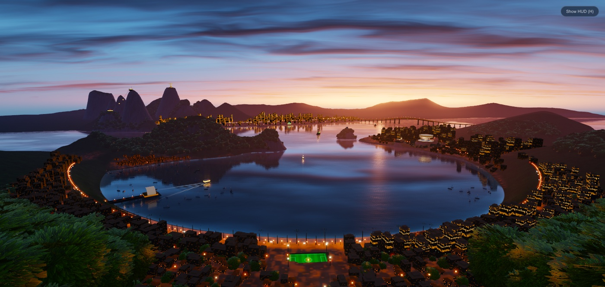
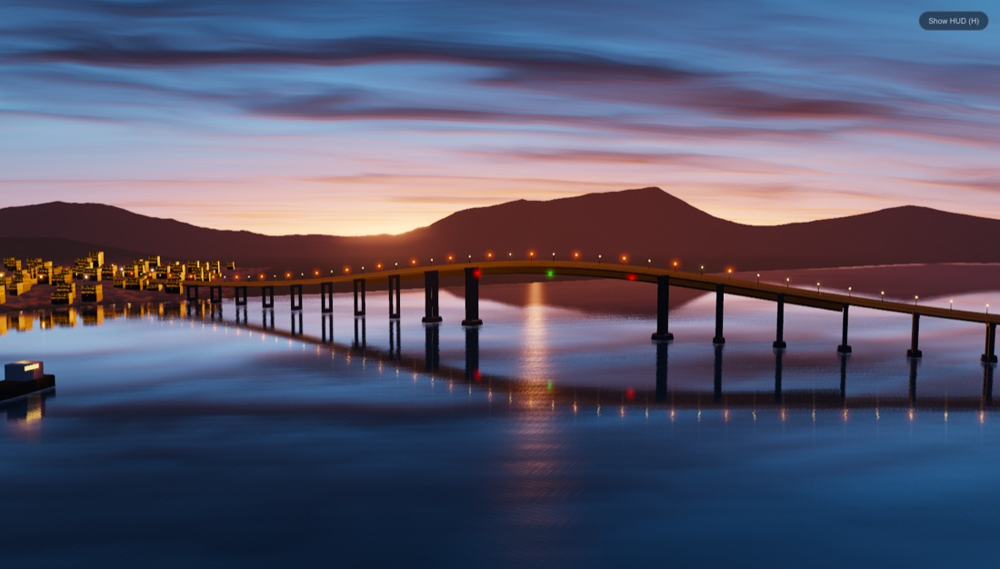
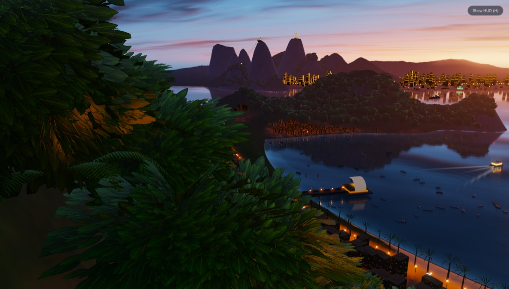
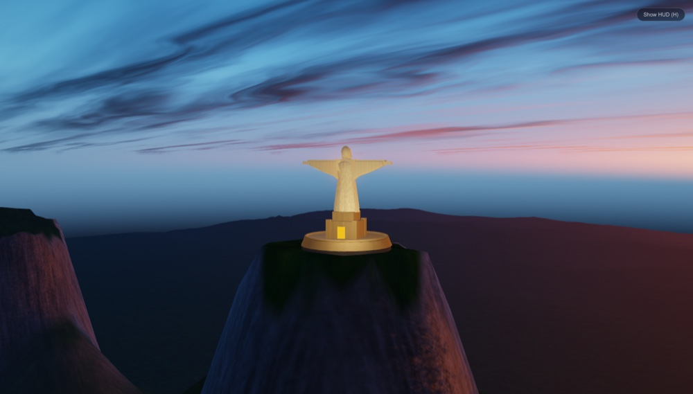
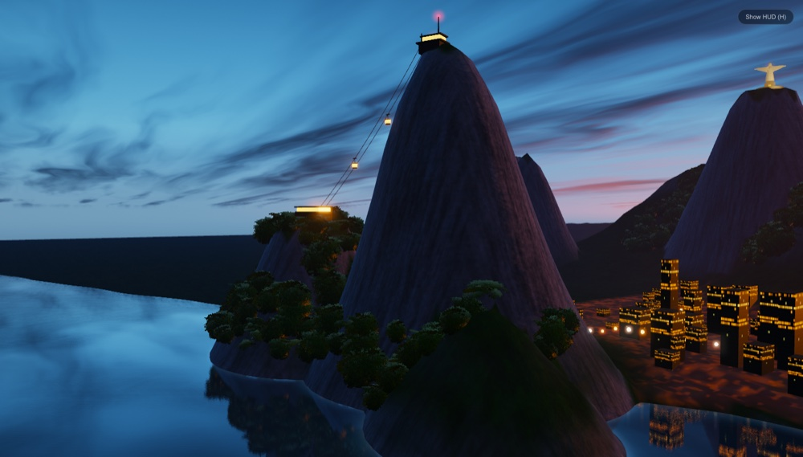
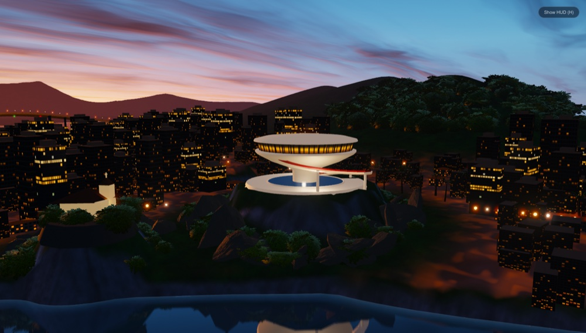

# Baía de Guanabara 3D (AAA Edition)

An interactive real-time 3D WebGL2 coastal panorama of **Baía de Guanabara** — viewed from **Parque da Cidade, Niterói** looking across **Enseada de São Francisco** toward **Rio de Janeiro** — built with **Three.js** and custom GLSL shaders with zero external 3D model or texture assets (100% procedural geometry & PBR synthesis).



## Visual Gallery

| HDR Water Reflections (Ponte Rio–Niterói) | Mata Atlântica Botanical Detail |
| :---: | :---: |
|  |  |

| Corcovado & Cristo Redentor | Pão de Açúcar & Bondinho | MAC Niterói & Ilha da Boa Viagem |
| :---: | :---: | :---: |
|  |  |  |

## Technical Highlights

- **Real-Time HDR Planar & Anisotropic Water Reflections** (`src/world/WaterSystem.js`, `src/shaders/waterShader.js`, `src/textures/terrainTextures.js`)
  - Dedicated mirrored-camera `HalfFloatType` HDR planar reflection pass (up to `2048×1280`, 4× MSAA) with Eric Lengyel oblique near-plane clipping.
  - **Dual-Pass GPU Anisotropic Vertical Light-Column Pre-Filter** stretching bright HDR coastal streetlamps, Ponte Rio–Niterói lights, Rio waterfront, and ships into continuous vertical shimmering light ribbons broken delicately by dual 512² seamless FFT-inspired swell & capillary normal maps.
  - **768² HalfFloat Per-Pixel Shoreline Depth Field** (`src/config/geography.js`) eliminating polygonal shoreline artifacts, combined with Beer-Lambert shallow beach absorption, meandering glassy calm wind-slick lanes vs satin breeze patches, Schlick Fresnel, GGX sunset glints, and a live catamaran Kelvin V-wake.
- **Multi-Species Mata Atlântica Botanical Vegetation** (`src/textures/vegetationTextures.js`, `src/world/VegetationSystem.js`, `src/shaders/foliageShader.js`)
  - Four procedurally synthesized botanical PBR texture suites: 1024² veined Broadleaf Rainforest (`Ficus / Jequitibá`), 1024² palmate star-lobed **Embaúba (Cecropia)**, 512×1024 **Jerivá / Imperial Palm** fronds (54 arched serrated leaflets), and 512×1024 **Giant Tree Fern (Samambaia)** rosettes — each with Sobel tangent-space normal maps and alpha-packed blade translucency masks.
  - Sculpted branching foreground tree trunks, multi-card volumetric crowns with inner-canopy AO, waxy cuticle twilight sheen, vein-modulated backlit emerald-gold subsurface scattering (SSS), warm upward city bounce, and hierarchical multi-frequency wind sway.
- **Recognizable Landmarks & Brazilian Coastal Architecture** (`src/world/LandmarksSystem.js`, `src/world/CitySystem.js`, `src/world/MaritimeSystem.js`)
  - **Corcovado & Cristo Redentor**: Art Deco vertical-pleated soapstone (`pedra-sabão` mosaic) statue, stepped *Capela de Nossa Senhora Aparecida* pedestal, and asymmetric warm-key / cool-sky architectural floodlighting.
  - **Pão de Açúcar, Morro da Urca & Bondinho**: Striated granite monoliths, cantilevered observation stations, 3D metallic `TubeGeometry` suspension cables, and animated faceted panoramic glass Bondinho gondolas.
  - **MAC Niterói & Ilha da Boa Viagem**: Oscar Niemeyer's cantilevered saucer with 3D exterior slanted glass mullions, sky-reflecting *espelho d'água*, sweeping red-carpeted spiral ramp on grounded piers, plus the colonial *Capela da Boa Viagem* & arched stone footbridge.
  - **Ponte Rio–Niterói**: Twin viaduct carriageways with safety barriers, 42 twin H-frame concrete piers with crossbeams & waterline ship fenders, elevated steel **Vão Central** span with marine beacons, and dual-lane animated traffic.
  - **Estação Hidroviária de Charitas**, **Fortaleza de Santa Cruz da Barra**, **Ilha Fiscal**, **Santos Dumont Airport** waterfront beacons, 3-archetype coastal buildings (modernist apartments, twilight glass towers, terracotta-roofed villas), floodlit São Francisco football pitch, and sculpted tapered-hull maritime vessels.
- **Volumetric-Look Multi-Altitude Sky & Filmic HDR Post-Processing** (`src/shaders/skyShader.js`, `src/post/PostProcessor.js`)
  - 3-altitude cloud decks with 3-step optical-depth self-shadowing across **Twilight**, **Golden Hour**, **Deep Blue Hour**, and **Rio Night** moods.
  - 4× MSAA HalfFloat HDR rendering, NaN-safe pre-bloom sanitizer, selective `UnrealBloomPass`, ACES Filmic tone mapping, shadow-highlight split grading, and anti-banding micro-dither.

## Quick Start

```bash
npm install
npm run dev
```

Open `http://127.0.0.1:5173/` in a WebGL2-capable browser.

### Production Build & Preview

```bash
npm run build
npm run preview
```

### Deploy to GitHub Pages

A ready-to-use GitHub Actions workflow is included at `.github/workflows/deploy-pages.yml`. Push to `main` and enable **Settings → Pages → Source: GitHub Actions**.

## Controls & URL Parameters

- **Left-drag**: Orbit · **Right-drag**: Pan · **Scroll**: Zoom
- **WASD / Q / E (+ Shift)**: Smooth free-fly camera
- **1–7**: Smooth cinematic camera flights between landmark presets
- **L**: Toggle 3D landmark pins · **H**: Toggle cinema mode (hide HUD) · **Space**: Pause/resume animation

Supported query parameters:
- `?preset=parque|sugarloaf|cristo|mac|bridge|beach|forest`
- `?mood=twilight|golden|bluehour|night`
- `?hud=0` (start in cinema mode) · `?labels=1` (show 3D landmark pins)

## Project Structure

```text
├── .github/workflows/deploy-pages.yml
├── docs/images/                # Preview renders for README
├── index.html
├── package.json
├── vite.config.js
└── src/
    ├── main.js                 # Bootstrap, HDR render loop & debug handle
    ├── styles.css              # Glassmorphic HUD & 3D landmark pins
    ├── config/
    │   ├── geography.js        # Analytical topography & 768² HalfFloat shore field
    │   ├── landmarksData.js    # Camera presets & 3D landmark pins
    │   └── lightingPresets.js  # Twilight, Golden, Blue Hour & Night moods
    ├── shaders/
    │   ├── skyShader.js        # Multi-altitude cloud decks & twilight sky
    │   ├── waterShader.js      # Planar + anisotropic reflection & optical bay shader
    │   ├── terrainShader.js    # Triplanar granite, rainforest, sand & coastal avenue
    │   └── foliageShader.js    # Botanical vein normals, cuticle sheen & backlit SSS
    ├── textures/
    │   ├── vegetationTextures.js
    │   ├── terrainTextures.js
    │   └── cityTextures.js
    ├── world/
    │   ├── TerrainSystem.js
    │   ├── WaterSystem.js
    │   ├── VegetationSystem.js
    │   ├── LandmarksSystem.js
    │   ├── CitySystem.js
    │   └── MaritimeSystem.js
    ├── post/PostProcessor.js   # Selective HDR Bloom + ACES Filmic grade
    └── ui/HudController.js
```

## License

MIT — see [LICENSE](./LICENSE).
